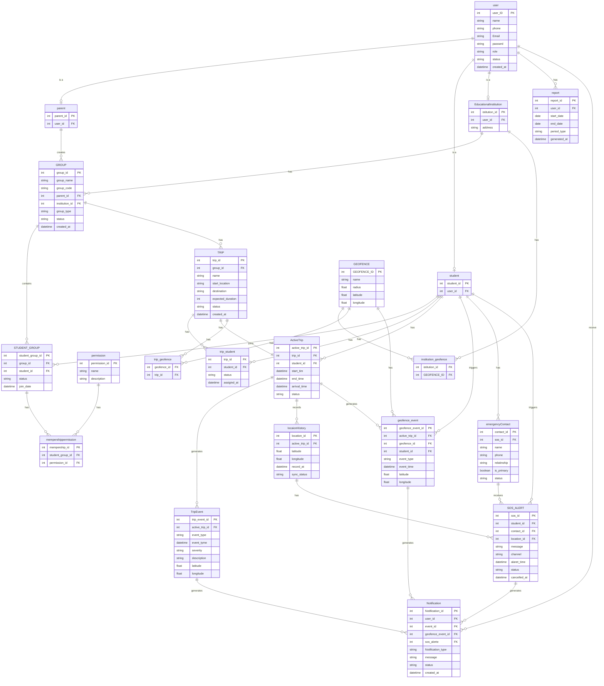

# ERD: Safe Path (المسار الآمن)

Source: the graduation report `التوثيق النهائي.pdf`, section 3.10 "مخطط العلاقات والكيانات (ERD)", page 30.

This file transcribes the diagram. Entity, attribute and relationship names are copied exactly as drawn, spelling mistakes included, so the file can be checked against the PDF. Section 5 lists the problems found while transcribing.

Notation used in the original diagram:

- A solid underline marks a primary key (PK).
- A dashed underline marks a foreign key (FK).
- Cardinality is written as `1` and `m` on each side of a relationship diamond.
- The diagram gives no data types. The types in the Mermaid diagram below are my own guesses, added only because Mermaid requires a type. The entity tables in section 2 list names only.

## 1. Diagram

## 2. Entities

There are 21 entities, grouped by area.

### 2.1 Users and roles

**user**

| Attribute | Key |
|---|---|
| user_ID | PK |
| name | |
| phone | |
| Email | |
| passwrd | |
| role | |
| status | |
| created_at | |

**parent**

| Attribute | Key |
|---|---|
| parent_id | PK |
| user_id | FK → user |

**student**

| Attribute | Key |
|---|---|
| student_id | PK |
| user_id | FK → user |

**EducationalInstitution**

| Attribute | Key |
|---|---|
| istitution_id | PK |
| user_id | FK → user |
| address | |

**report**

| Attribute | Key |
|---|---|
| report_id | PK |
| user_id | FK → user |
| start_date | |
| end_date | |
| period_type | |
| generated_at | |

### 2.2 Groups and permissions

**GROUP**

| Attribute | Key |
|---|---|
| group_id | PK |
| group_name | |
| group_code | |
| parent_id | FK → parent |
| institution_id | FK → EducationalInstitution |
| group_type | |
| status | |
| created_at | |

**STUDENT_GROUP** (a student's membership in a group)

| Attribute | Key |
|---|---|
| student_group_id | PK |
| group_id | FK → GROUP |
| student_id | FK → student |
| status | |
| join_date | |

**permission**

| Attribute | Key |
|---|---|
| permission_id | PK |
| name | |
| description | |

**mempershippermission** (the permissions granted to one membership)

| Attribute | Key |
|---|---|
| mempership_id | PK |
| student_group_id | FK → STUDENT_GROUP |
| permission_id | FK → permission |

### 2.3 Trips and tracking

**TRIP** (a planned trip that belongs to a group)

| Attribute | Key |
|---|---|
| trip_id | PK |
| group_id | FK → GROUP |
| name | |
| start_location | |
| destination | |
| expected_duration | |
| status | |
| created_at | |

**trip_student** (students assigned to a trip)

| Attribute | Key |
|---|---|
| trip_id | FK → TRIP |
| student_id | FK → student |
| status | |
| assigind_at | |

**ActiveTrip** (one student running a trip right now)

| Attribute | Key |
|---|---|
| active_trip_id | PK |
| trip_id | FK → TRIP |
| student_id | FK → student |
| start_tim | |
| end_time | |
| arrival_time | |
| status | |

**TripEvent**

| Attribute | Key |
|---|---|
| trip_event_id | PK |
| active_trip_id | FK → ActiveTrip |
| event_type | |
| event_tyme | |
| severity | |
| description | |
| latitude | |
| longitude | |

**locaionHistory** (GPS points recorded during an active trip)

| Attribute | Key |
|---|---|
| location_id | PK |
| active_trip_id | FK → ActiveTrip |
| latitude | |
| longitude | |
| record_at | |
| sync_status | |

### 2.4 Geofencing

**GEOFENCE** (a circle defined by a centre point and a radius)

| Attribute | Key |
|---|---|
| GEOFENCE_ID | PK |
| name | |
| radius | |
| latitude | |
| longitude | |

**institution_geofence** (links institutions to geofences)

| Attribute | Key |
|---|---|
| istitution_id | FK → EducationalInstitution |
| GEOFENCE_ID | FK → GEOFENCE |

**trip_geofence** (links trips to geofences)

| Attribute | Key |
|---|---|
| geofence_id | FK → GEOFENCE |
| trip_id | FK → TRIP |

**geofence_event** (a student entering or leaving a geofence)

| Attribute | Key |
|---|---|
| geofence_event_id | PK |
| active_trip_id | FK → ActiveTrip |
| geofence_id | FK → GEOFENCE |
| student_id | FK → student |
| event_type | |
| event_time | |
| latitude | |
| longitude | |

### 2.5 Safety and notifications

**emergencyContact**

| Attribute | Key |
|---|---|
| contact_id | PK |
| sos_id | FK → SOS_ALERT |
| name | |
| phone | |
| relatinship | |
| is_primary | |
| status | |

**SOS_ALERT**

| Attribute | Key |
|---|---|
| sos_id | PK |
| student_id | FK → student |
| contact_id | FK → emergencyContact |
| location_id | FK → locaionHistory |
| message | |
| channel | |
| alaret_time | |
| status | |
| cancelled_at | |

**Notification**

| Attribute | Key |
|---|---|
| Notification_id | PK |
| user_id | FK → user |
| event_id | FK → TripEvent |
| geofence_event_id | FK → geofence_event |
| sos_alerte | FK → SOS_ALERT |
| Notification_type | |
| message | |
| status | |
| created_at | |

## 3. Relationships

There are 32 relationships, read as "one A … many B". The diagram draws the three role links from `user` as plain lines without a diamond or cardinality.

| # | One side | Relationship | Many side | Cardinality |
|---|---|---|---|---|
| 1 | user | is a | parent | 1 : 1 (subtype, no cardinality drawn) |
| 2 | user | is a | student | 1 : 1 (subtype, no cardinality drawn) |
| 3 | user | is a | EducationalInstitution | 1 : 1 (subtype, no cardinality drawn) |
| 4 | user | has | report | 1 : m |
| 5 | user | receve | Notification | 1 : m |
| 6 | parent | creates | GROUP | 1 : m |
| 7 | EducationalInstitution | has | GROUP | 1 : m |
| 8 | GROUP | contains | STUDENT_GROUP | 1 : m |
| 9 | student | joins | STUDENT_GROUP | 1 : m |
| 10 | STUDENT_GROUP | has | mempershippermission | 1 : m |
| 11 | permission | has | mempershippermission | 1 : m |
| 12 | GROUP | has | TRIP | 1 : m |
| 13 | TRIP | has | trip_student | 1 : m |
| 14 | student | has | trip_student | 1 : m |
| 15 | TRIP | has | ActiveTrip | **1 : 1** |
| 16 | student | has | ActiveTrip | 1 : m |
| 17 | ActiveTrip | generates | TripEvent | 1 : m |
| 18 | ActiveTrip | records | locaionHistory | 1 : m |
| 19 | EducationalInstitution | has | institution_geofence | 1 : m |
| 20 | GEOFENCE | has | institution_geofence | 1 : m |
| 21 | GEOFENCE | has | trip_geofence | 1 : m |
| 22 | TRIP | has | trip_geofence | 1 : m |
| 23 | GEOFENCE | has | geofence_event | 1 : m |
| 24 | ActiveTrip | generates | geofence_event | 1 : m |
| 25 | student | triggers | geofence_event | 1 : m |
| 26 | student | has | emergencyContact | 1 : m |
| 27 | student | triggers | SOS_ALERT | 1 : m |
| 28 | emergencyContact | receives | SOS_ALERT | 1 : m |
| 29 | locaionHistory | has | SOS_ALERT | 1 : m |
| 30 | SOS_ALERT | generates | Notification | 1 : m |
| 31 | TripEvent | generates | Notification | 1 : m |
| 32 | geofence_event | generates | Notification | 1 : m |

## 4. How the pieces fit

- **One login table.** Every person or organisation is a `user`. The `role` column says which of the three role tables (`parent`, `student`, `EducationalInstitution`) holds the rest of their data.
- **Groups connect students to whoever watches them.** A group is created by a parent or by an institution. Students join through `STUDENT_GROUP`, and each membership carries its own set of permissions through `mempershippermission`.
- **A trip is a plan, an active trip is a run.** `TRIP` belongs to a group and lists its students in `trip_student`. When a student starts the trip, an `ActiveTrip` row is created. Everything that happens during the run hangs off it: GPS points (`locaionHistory`), trip events (`TripEvent`) and geofence crossings (`geofence_event`).
- **Geofences are reusable.** One `GEOFENCE` can be attached to institutions and to trips through the two link tables.
- **Alerts fan out as notifications.** An SOS alert, a trip event or a geofence event each produce `Notification` rows, and each notification goes to one `user`.

## 5. Problems found in the diagram

None of these are fixed in the sections above. They need a decision before the schema is built.

### 5.1 Structural problems

| # | Problem | Suggested fix |
|---|---|---|
| P1 | **The SOS and emergency contact keys point at each other.** `emergencyContact` has `sos_id` and `SOS_ALERT` has `contact_id`. A contact exists before any alert, so `sos_id` cannot be filled when the contact is created. | Drop `sos_id` from `emergencyContact`. |
| P2 | **emergencyContact has no owner column.** Relationship 26 says a student has many contacts, but `emergencyContact` has no `student_id`. | Add `student_id` FK → student. |
| P3 | **TRIP to ActiveTrip is drawn 1 : 1.** `ActiveTrip` holds a `student_id`, so a trip with several students, or a trip run on several days, needs many active trips. | Make it 1 : m. |
| P4 | **The link tables have no primary key.** `trip_student`, `institution_geofence` and `trip_geofence` mark no key, so duplicate rows are possible. | Use a composite PK on the two FK columns. |
| P5 | **A group has two possible creators.** `GROUP` has both `parent_id` and `institution_id`, with no rule that exactly one is filled. | Add a check that exactly one is set, or replace both with a single `created_by` → user. |
| P6 | **Notification has three nullable source keys.** `event_id`, `geofence_event_id` and `sos_alerte` all sit on one row, and nothing stops zero or several being set. | Add a check that exactly one is set, or use `source_type` + `source_id`. |
| P7 | **geofence_event repeats student_id.** The student can already be found through `active_trip_id` → `ActiveTrip.student_id`, so the two can disagree. | Drop `student_id` from `geofence_event`, or keep it on purpose for faster queries. |
| P8 | **SOS_ALERT.location_id points at one GPS row.** A location row belongs to an active trip, so an SOS raised outside a trip has no location to point at. | Store latitude and longitude directly on `SOS_ALERT`. |
| P9 | **TripEvent's key is unclear.** In the drawing `active_trip_id` is underlined and `trip_event_id` is not, but `trip_event_id` is the only column that can be unique. | `trip_event_id` PK, `active_trip_id` FK, as shown in section 2. |

### 5.2 Spelling mistakes in the diagram

| As drawn | Should be |
|---|---|
| passwrd | password (store a hash: `password_hash`) |
| istitution_id | institution_id |
| mempershippermission, mempership_id | membership_permission, membership_id |
| locaionHistory | location_history |
| relatinship | relationship |
| alaret_time | alert_time |
| start_tim | start_time |
| event_tyme | event_time |
| assigind_at | assigned_at |
| sos_alerte | sos_id |
| receve | receives |
| Notification_id, Notification_type, Email, user_ID, GEOFENCE_ID | mixed case; use one style, e.g. snake_case lower case |
